# CAP 931: SalesIntel AI

Building an AI Sales Assistant

Learner: Zaheera Bhanu Shanawaz Ahamed  
Date: October 27, 2026  
Program: Per Scholas CAP 931

## Contents

1. Overview
2. Steps
3. Conclusion
4. Appendix

## Overview

For my CAP 931 project, I built SalesIntel AI. It helps a salesperson research
a company before a meeting. The user enters product and company details. The app
collects public information, checks the AI findings against the sources, and
creates a one-page sales brief.

I used Python, uv, Streamlit, Groq, Requests, BeautifulSoup, Pydantic, pypdf,
ReportLab, pytest, and Ruff. Groq runs three research roles: company strategy,
competitor research, and leadership research. These are focused model calls
managed by Python, not independent agents.

The app is a local student project. It reports missing evidence instead of
guessing, but a person should still review the results.

## Steps

### Step 1. Set up the project

I created a Python 3.12 project with uv. I kept the application code in
`src/cap_931` and separated the interface, prompts, research, document upload,
PDF generation, and tests.

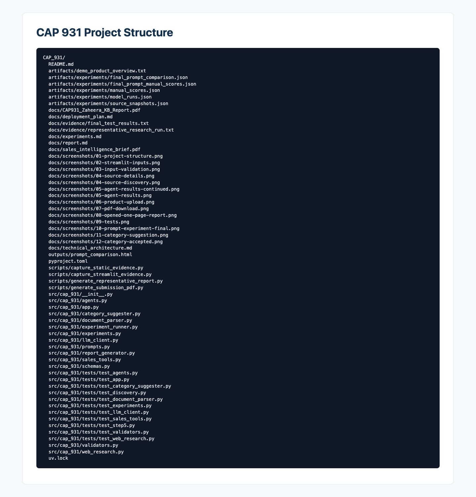

### Step 2. Build the Streamlit form

I added fields for product name, company URL, product category, competitor URLs,
target customer, and value proposition. Competitor URLs are optional. I also
added a PDF or TXT upload and a button that can suggest a category.

The final screenshots use SalesIntel AI, IBM, Salesforce, the AI Sales Research
category, and a Chief Revenue Officer target.

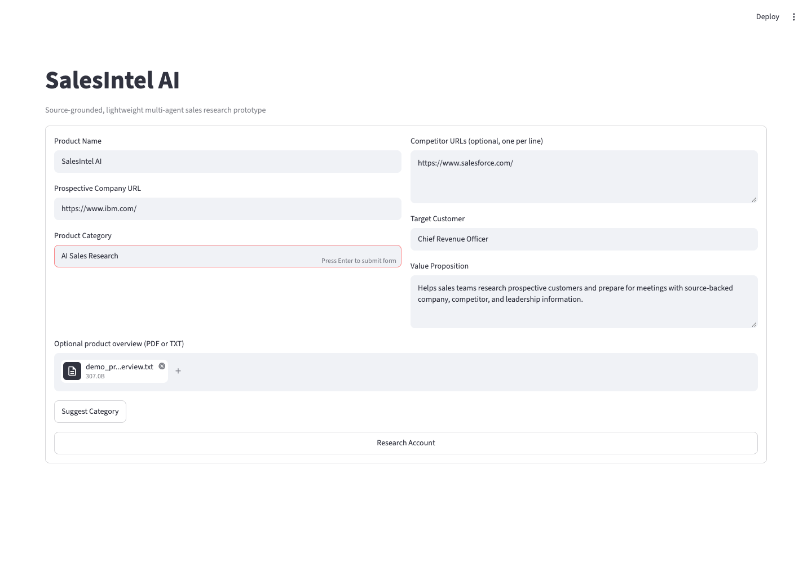

### Step 3. Validate the input

The app checks required fields and blocks unsafe URLs. It rejects empty,
oversized, encrypted, broken, and unsupported uploads. Uploaded product text is
seller information. It is not evidence about the company being researched.

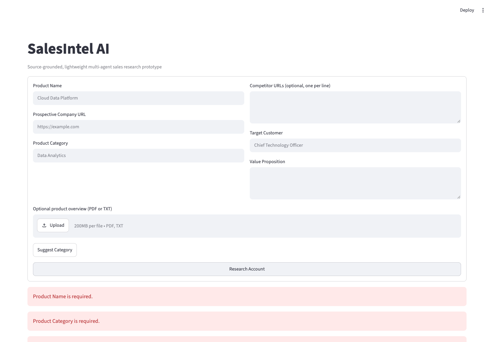

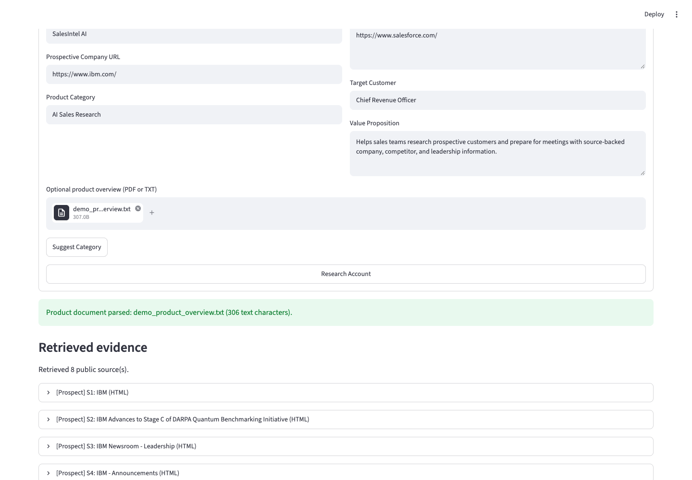

### Step 4. Connect Groq

I first tried Google AI Studio, but I had project permission and subscription
errors. I switched to Groq and used the `openai/gpt-oss-20b` model. Groq worked
with the Python SDK and could return the structured JSON used by the app.

I wrote separate prompts for company strategy, competitor research, and
leadership. Pydantic checks that each response has the expected fields. The
Groq free tier also has request and token limits, so the app keeps its source
text and model responses bounded.

### Step 5. Retrieve public information

The app follows a small number of useful links on company websites. It looks for
news, strategy, leadership, investor, product, career, and technology pages.
Each successful source receives an ID and a prospect or competitor label.

In the final example, the app retrieved four IBM pages and four Salesforce
pages.

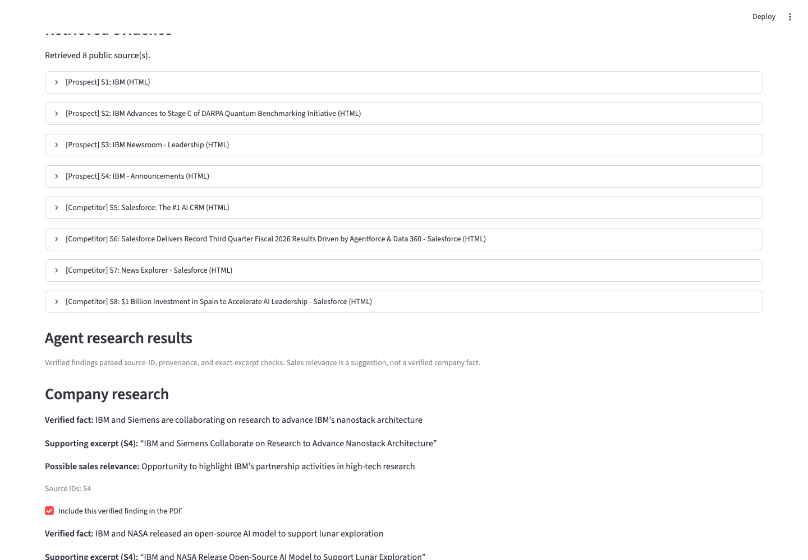

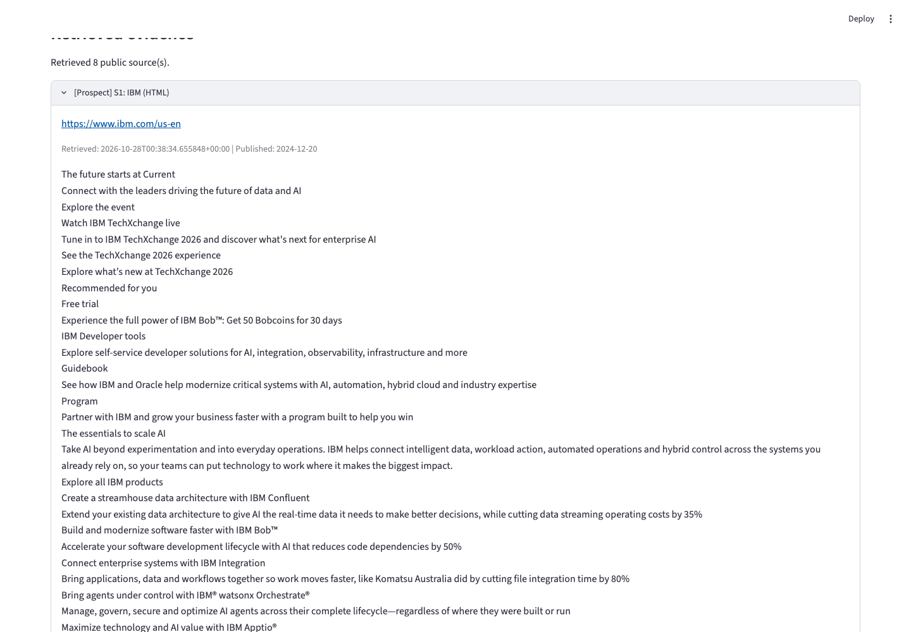

### Step 6. Handle website problems

I added limits for redirects, page size, time, and total research. Redirect
loops, blocked pages, and unreadable pages become warnings instead of evidence.
The app does not bypass CAPTCHAs, login pages, paywalls, or robots rules.

Microsoft and Oracle blocked some requests during testing. This taught me that
public websites are not always available to automated tools.

### Step 7. Check the AI findings

Every verified finding needs a source ID and a short excerpt. Python checks that
the excerpt appears in the selected source. Sales relevance is shown separately
because it is a suggestion, not a verified company fact.

A matching excerpt is helpful, but it does not prove that the complete claim is
correct. Important findings still need human review.

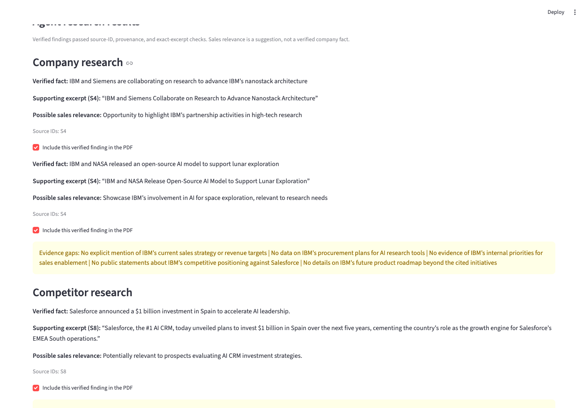

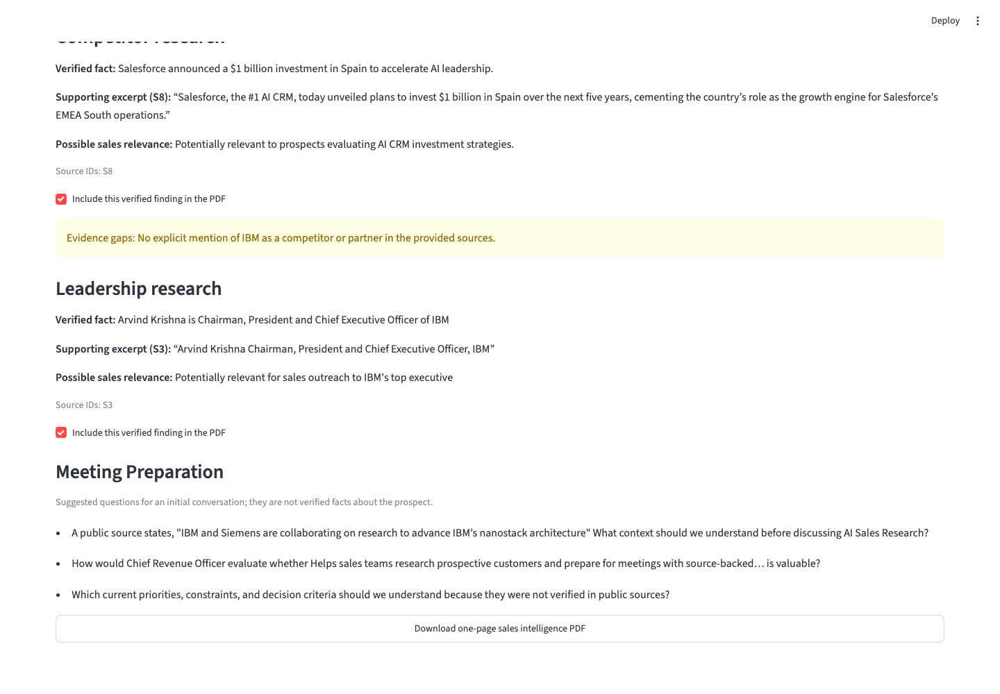

### Step 8. Keep sources separate

Company and leadership findings must use prospect sources. Competitor research
can use both source types, but competitor information cannot be reported as a
fact about the prospect.

The user can exclude a supported finding before creating the PDF. This review
step cannot turn unsupported text into a verified fact.

### Step 9. Add meeting questions

The app creates up to three suggested questions from the product details,
verified findings, and missing evidence. When little evidence is available, the
questions stay neutral instead of assuming that the company has a need.

### Step 10. Create the one-page PDF

I used ReportLab to create the sales brief. It includes company, competitor, and
leadership sections, meeting questions, evidence gaps, and source links. pypdf
checks that the result has exactly one page.

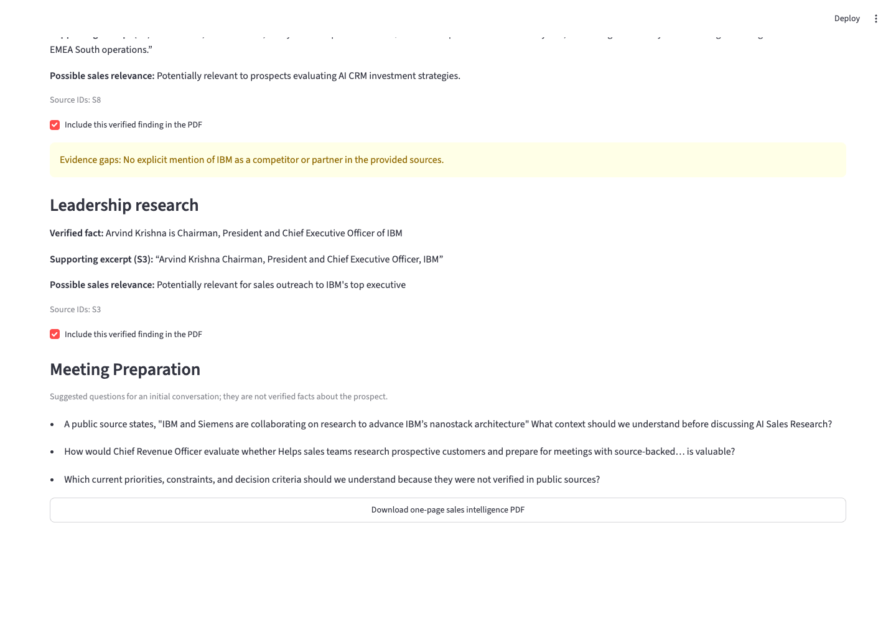

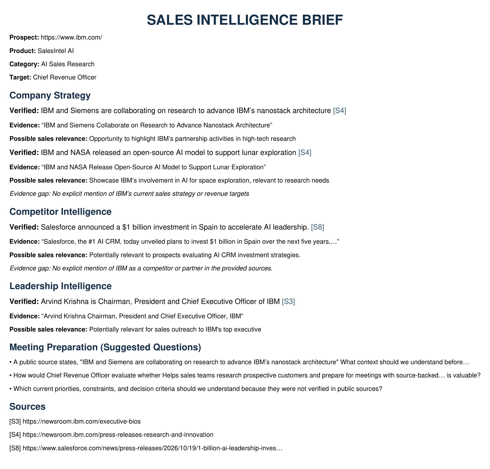

### Step 11. Compare prompts

I compared different prompt structures using the same saved sources. In the
final comparison, specialized v3.1 scored 3.57 out of 5 and used 3,409 tokens.
Grounded-sales v1.1 scored 3.43 and used 3,806 tokens.

The grounded-sales prompt returned more findings, but more information did not
automatically mean better information. This was a small experiment, so the
result cannot show that one prompt is always better.

The first baseline prompt also returned the wrong JSON structure. I added a
clearer example and category rules before running baseline v1.1. Later prompt
versions had similar formatting mistakes, which taught me to test both the
prompt wording and the response schema.

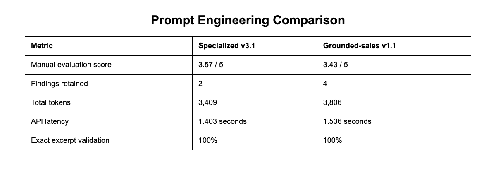

### Step 12. Test the application

I tested input validation, website retrieval, redirects, blocked pages, uploads,
prompt responses, citations, human review, meeting questions, and PDF output.

Final local results:

- 98 automated tests passed
- Ruff passed
- All Python modules compiled
- The sales brief opened as one page

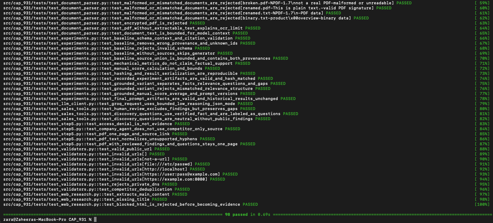

## Conclusion

I built a working local sales research assistant with a Streamlit interface,
three Groq research roles, public website research, source checks, and PDF
export.

The most difficult part was not connecting the model. It was finding readable
website information and keeping each claim connected to the correct company.
Blocked websites also showed me why the app needs clear evidence gaps.

I also had missing-module and function-interface errors while joining the
project steps. I fixed them by restoring the package files, checking each
module's inputs and outputs, and running the full tests after every integration.

I learned that a source link alone does not prove an AI-generated statement.
The prompt comparison also showed me that more findings do not always make a
better result.

If I continue this project, I would test more company pairs, add another human
reviewer, and improve public-source coverage. I would not treat the current
prototype as a production system.

## Appendix

### Final results

- 98 tests passed
- Four IBM and four Salesforce pages were retrieved in the final displayed run
- The representative sales brief contains one page
- No API key is stored in the publishable files

### Final prompt comparison

| Approach | Manual score | Findings | Tokens | API latency |
|---|---:|---:|---:|---:|
| Specialized v3.1 | 3.57 / 5 | 2 | 3,409 | 1.403 s |
| Grounded-sales v1.1 | 3.43 / 5 | 4 | 3,806 | 1.536 s |

### Time management

I worked in stages: interface, validation, Groq connection, website research,
document upload, PDF output, prompt testing, and final verification. I do not
have a reliable hour-by-hour record, so I did not invent one.

### Deployment summary

The app runs locally. A production version would need user login, managed API
keys, request limits, private upload rules, monitoring, and stronger network
controls. Python URL checks reduce risk, but production would also need
restricted outbound network access. The [deployment plan](deployment_plan.md)
explains these items. The project is not currently deployed.

### GitHub and references

- [GitHub repository](https://github.com/zbstarlab/CAP_931_Zaheera_Bhanu)
- [Project README](../README.md)
- [Technical architecture](technical_architecture.md)
- [Prompt experiments](experiments.md)
- [Deployment plan](deployment_plan.md)
- [Final test results](evidence/final_test_results.txt)
- [Sales intelligence brief](sales_intelligence_brief.pdf)
- [CAP 931 report PDF](CAP931_Zaheera_Report.pdf)
